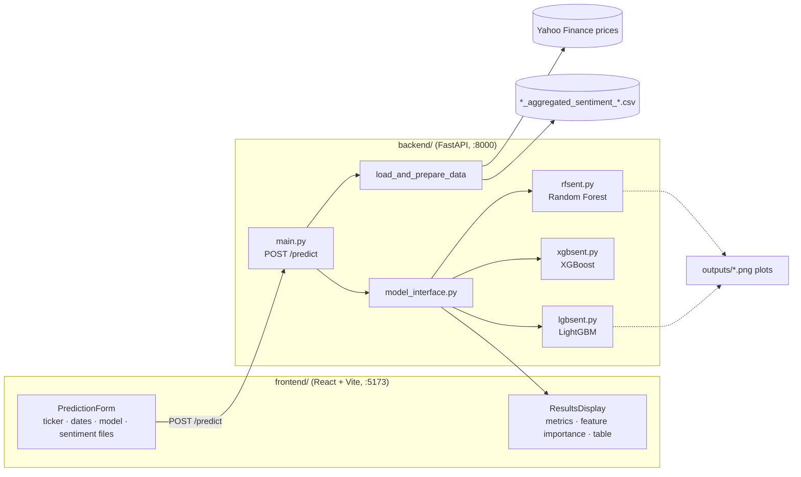

# Sentiment-Based Stock Prediction

Predicts a stock's **next-day closing price** by combining its price history and technical indicators with the **daily sentiment of news articles** about it. You pick a ticker, a date range, one or more sentiment files and a model (Random Forest, XGBoost or LightGBM). The app trains it and shows how well it did: error metrics, which features mattered most, and predicted versus actual prices.

News sentiment data for **Tesla (TSLA)** and **Realty Income (O)** from 2015 to early 2025 is included.

## How it fits together



## The model

**Features** for each trading day:

- the previous day's close, high, low and volume;
- technical indicators from the `ta` library: RSI (14), MACD, 20-day SMA and EMA, ATR;
- **Sentiment**: that day's average news sentiment from the chosen CSV files.

**Target:** the next day's closing price.

**Output:** MSE, RMSE, R², MAE, MAPE and explained variance; feature importance; the predicted and actual price series with dates; and a saved plot in `backend/outputs/`.

### Sentiment files

Each `backend/<TICKER>_aggregated_sentiment_<start>_<end>.csv` has one row per day:

| Column | Meaning |
|---|---|
| `date` | Day |
| `avg_sentiment` | Average sentiment score of that day's articles |
| `article_count` | Number of articles |
| `sentiment_std` | Spread of sentiment across articles |
| `unique_sources` | Number of distinct outlets |
| `article_urls`, `headlines` | The articles used |

## Running it

**Backend** (Python 3.10+):

```bash
cd backend
pip install fastapi uvicorn pydantic yfinance pandas numpy scikit-learn xgboost lightgbm ta matplotlib
python main.py                  # http://localhost:8000
```

**Frontend:**

```bash
cd frontend
npm install
npm run dev                     # http://localhost:5173
```

The frontend calls `http://127.0.0.1:8000` (set in `frontend/src/services/api.js`), and the backend only accepts browser requests from `http://localhost:5173`.

### API

`POST /predict`

```json
{
  "ticker": "TSLA",
  "start_date": "2023-01-01",
  "end_date": "2025-01-13",
  "model": "lightgbm",
  "sentiment_files": ["TSLA_aggregated_sentiment_20230101_20250113.csv"]
}
```

`model` is one of `random_forest`, `xgboost` or `lightgbm`.

## Notes

- There's no `requirements.txt` yet; the install line above lists what the backend imports.
- The sentiment CSVs were produced separately. The scraping and scoring code isn't in this repo.

## Tech stack

Python · FastAPI · scikit-learn · XGBoost · LightGBM · ta · yfinance · pandas · matplotlib · React · Vite · Tailwind CSS
